# Scene bank

62 original scenes in 18 categories. Generated by `node studio.mjs docs` from `scene-bank/*/*/meta.json` — do not edit by hand.

By mode: 3d 9 · kinetic-typography 22 · print 8 · ui-motion 12 · cinematic 7 · talking-head 4

Every scene takes the standard variables `duration`, `in`, `out` and `palette` (night, paper, orange, navy, mono) besides its own. Text variables accept `*accent*` and `|` line breaks. Defaults exist in Albanian, English and Italian.

## 3d-environments

### `room-model-3d` — Architectural model (floor plan rises)

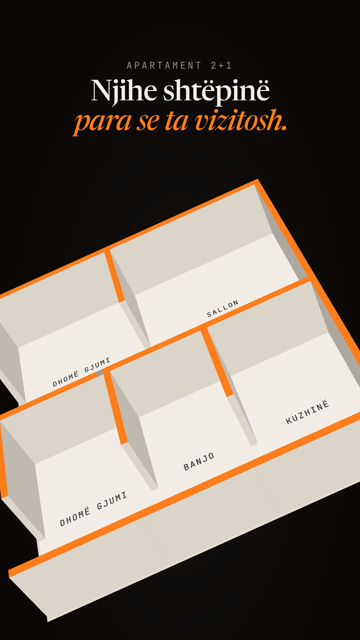

**Mode:** 3d · **Default length:** 3.6 s · **In/out:** zoom-out / blur

An architect's model: a paper floor plate lands on an isometric plane, thin CSS-3D walls (orange-capped) grow up room by room, room labels pop in and the model slowly orbits. The plan is illustrative ('2+1' layout), not a real listing's drawing.

| Variable | Type | Default |
|---|---|---|
| `kicker` | string | Apartament 2+1 |
| `title` | string | Njihe shtëpinë *para se ta vizitosh.* |
| `r1` | string | Dhomë gjumi |
| `r2` | string | Sallon |
| `r3` | string | Dhomë gjumi |
| `r4` | string | Banjo |
| `r5` | string | Kuzhinë |

> Illustrative layout: never present it as the floor plan of a specific listing.

 

### `screens-depth-dolly` — Dolly through floating screens

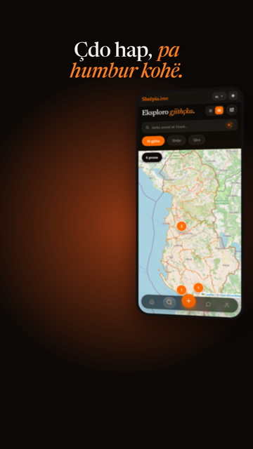

**Mode:** 3d · **Default length:** 3.6 s · **In/out:** none / blur

Real screens float in 3D space along an S path; the camera dollies forward through them while a computed depth of field blurs each screen by its distance from the focus plane, so focus passes from screen to screen.

| Variable | Type | Default |
|---|---|---|
| `title` | string | Çdo hap, *pa humbur kohë.* |
| `screens` | string | home, explore, detail-1, map |
| `theme` | enum | dark |

Features shown: `search`, `grid-view`, `listing-detail`, `map-view`

 

### `three-pin-drop` — 3D pin drop (Three.js)

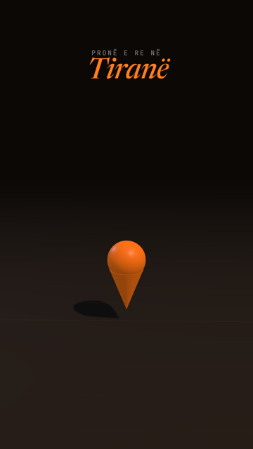

**Mode:** 3d · **Default length:** 3 s · **In/out:** none / blur · **WebGL**

WebGL: a lit orange map pin falls onto a gridded ground plane on a closed-form spring (damping 0.5), casting a soft shadow; a single ripple ring spreads from the landing point while the camera arcs slowly and the place name types in letter by letter.

| Variable | Type | Default |
|---|---|---|
| `kicker` | string | Pronë e re në |
| `place` | string | *Tiranë* |

 

## call-to-actions

### `cta-app-icon` — App icon call to action

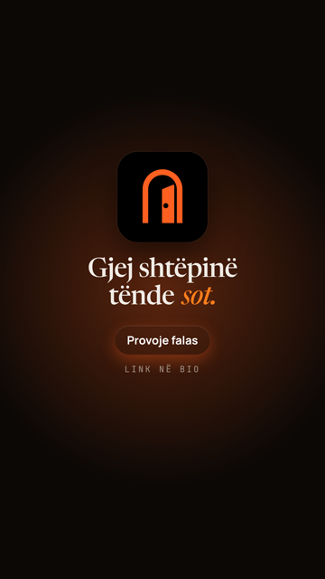

**Mode:** kinetic-typography · **Default length:** 3 s · **In/out:** blur / none

The official app icon (dark or light) lands on an elastic spring with a soft glow, the line sharpens in, an orange button pops and is pressed once at the end — the final ask, held long enough to act on.

| Variable | Type | Default |
|---|---|---|
| `title` | string | Gjej shtëpinë tënde *sot.* |
| `button` | string | Provoje falas |
| `small` | string | Link në bio |
| `icon` | enum | dark |

> Only say 'App Store / Google Play' once the app is actually published there. 'Falas' (free) must be true for the user side.

 

### `cta-button-press` — Button press floods the frame

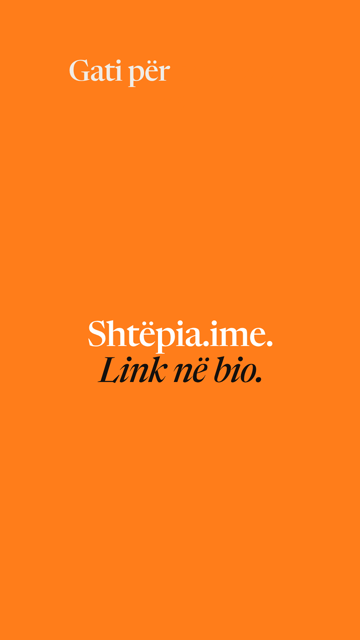

**Mode:** kinetic-typography · **Default length:** 3.4 s · **In/out:** none / none

A large orange button pops in, its arrow nudges twice (finite yoyo), then it is pressed (sink and spring back) and the accent floods out of it as an iris into a final line — the press causes the cut.

| Variable | Type | Default |
|---|---|---|
| `title` | string | Gati për *shtëpinë e re?* |
| `button` | string | Fillo kërkimin |
| `after` | string | Shtëpia.ime. *Link në bio.* |

 

### `cta-type-handle` — Typed handle / URL

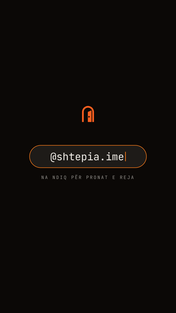

**Mode:** kinetic-typography · **Default length:** 3.2 s · **In/out:** blur / none

The official symbol settles, an accent-outlined field unrolls and the handle or URL types into it in mono at reading pace (fitted to the safe width), then the caret blinks a finite number of times under a short line.

| Variable | Type | Default |
|---|---|---|
| `text` | string | @shtepia.ime |
| `line` | string | Na ndiq për pronat e reja |

> @shtepia.ime is a placeholder handle (config/brand.json $todo): confirm it before publishing.

 

## city-environments

### `city-iso-rise` — Iso city rise (CSS 3D)

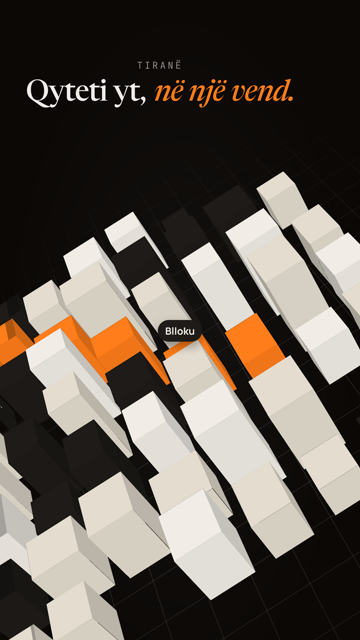

**Mode:** 3d · **Default length:** 3.4 s · **In/out:** zoom-out / zoom-in

A seeded isometric city of real CSS-3D prisms (five shaded faces, window texture) grows from the ground outward from the centre while the whole plane slowly orbits; orange accent towers mark listings. Sharp text, no WebGL.

| Variable | Type | Default |
|---|---|---|
| `kicker` | string | Tiranë |
| `title` | string | Qyteti yt, *në një vend.* |
| `pin` | string | Blloku |
| `seed` | number | 11 |

 

### `city-skyline-paper` — Paper skyline at sunset

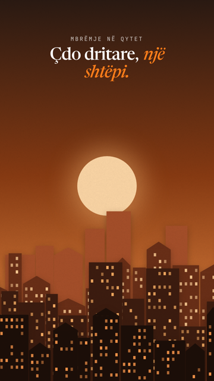

**Mode:** print · **Default length:** 3.4 s · **In/out:** none / blur

Four cut-paper skyline rows (seeded towers, lit windows, warm sunset ramp) rise one after another, then drift at different speeds for parallax while a paper sun sets behind them.

| Variable | Type | Default |
|---|---|---|
| `kicker` | string | Mbrëmje në qytet |
| `title` | string | Çdo dritare, *një shtëpi.* |
| `seed` | number | 3 |

 

### `city-three-dive` — City dive (Three.js)

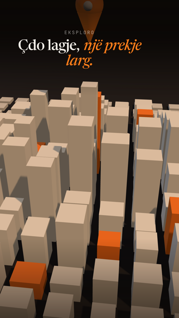

**Mode:** 3d · **Default length:** 3.6 s · **In/out:** none / blur · **WebGL**

WebGL: an instanced city (289 lit blocks, soft shadows, fog) grows outward while the camera dives from a high orbit to street level; an orange map pin drops on a closed-form spring onto the tallest block. Every frame is computed from timeline time.

| Variable | Type | Default |
|---|---|---|
| `kicker` | string | Eksploro |
| `title` | string | Çdo lagje, *një prekje larg.* |
| `seed` | number | 21 |

 

## feature-showcases

### `feature-dark-mode` — Light to dark mode

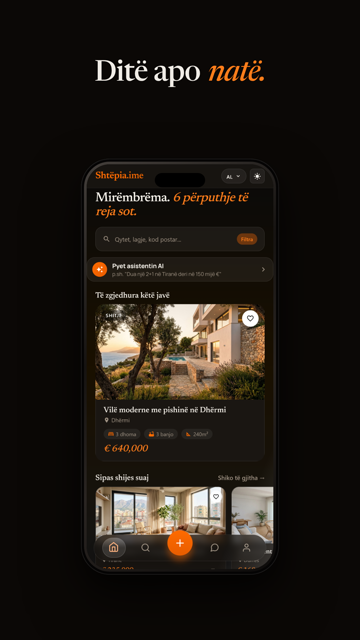

**Mode:** ui-motion · **Default length:** 2.8 s · **In/out:** none / blur

One real screen captured in both themes: a diagonal wipe crosses the phone and the world behind it at the same time, turning day into night; the headline changes ink with the ground.

| Variable | Type | Default |
|---|---|---|
| `title` | string | Ditë apo *natë.* |
| `screen` | screen | home |
| `at` | number | 0.9 |

Features shown: `dark-mode`

 

### `feature-favorites` — Save to favourites

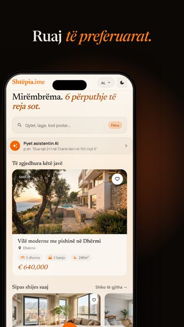

**Mode:** ui-motion · **Default length:** 3 s · **In/out:** none / blur

The camera flies to the real heart button on a listing, the button's own pixels depress under a press, and a burst of small orange hearts (seeded directions, clearly an overlay) celebrates the save before the camera pulls back.

| Variable | Type | Default |
|---|---|---|
| `title` | string | Ruaj *të preferuarat.* |
| `screen` | enum | home |
| `region` | string | featuredHeart |
| `zoom` | number | 2.4 |
| `theme` | enum | light |

Features shown: `favorites`

> For detail-1 set region to 'heart'.

 

### `feature-languages` — Eight languages

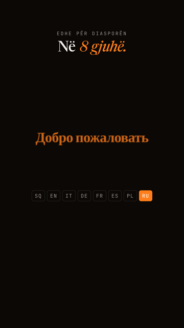

**Mode:** kinetic-typography · **Default length:** 4.2 s · **In/out:** none / blur

A welcome word rolls through the app's eight real locales (sq, en, it, de, fr, es, pl, ru) one after another — each fitted to the safe width — while the matching language code lights up in a row of mono plates.

| Variable | Type | Default |
|---|---|---|
| `kicker` | string | Edhe për diasporën |
| `title` | string | Në *8 gjuhë.* |

Features shown: `multilingual`

 

### `feature-spotlight` — Feature spotlight

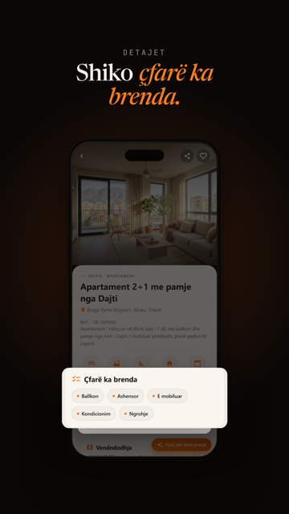

**Mode:** ui-motion · **Default length:** 3.2 s · **In/out:** none / blur

The generic feature beat: a real screen, the rest of it dims under a spotlight, the chosen region lifts off the glass towards the viewer as a card of the app's own pixels, and a callout names it. Pick any screen + region from config/screens.json.

| Variable | Type | Default |
|---|---|---|
| `kicker` | string | Detajet |
| `title` | string | Shiko *çfarë ka brenda.* |
| `screen` | screen | detail-1 |
| `region` | string | amenities |
| `callout` | string |  |
| `scale` | number | 1.25 |
| `lift` | number | -40 |
| `theme` | enum | light |

Features shown: `amenities`

 

## hooks

### `hook-city-slot` — City slot-machine hook

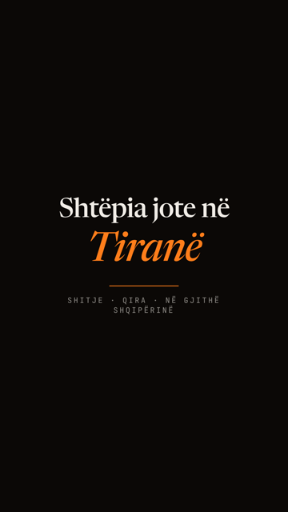

**Mode:** kinetic-typography · **Default length:** 2.8 s · **In/out:** none / whip-up

The lead line is on frame 0; the last word rolls like a slot machine through real Albanian places (drop-in per roll, pure function of time) and lands on the final one, then a rule draws and a quiet line blurs in.

| Variable | Type | Default |
|---|---|---|
| `lead` | string | Shtëpia jote në |
| `options` | string | Sarandë, Vlorë, Durrës, Gjirokastër, Dhërmi, Tiranë |
| `sub` | string | Shitje · Qira · Në gjithë Shqipërinë |

Features shown: `search`, `listing-type`

 

### `hook-paper-door` — Paper door opens

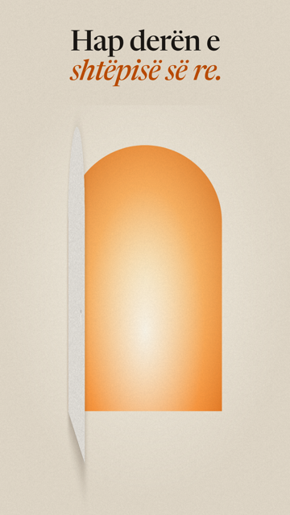

**Mode:** print · **Default length:** 2.6 s · **In/out:** none / zoom-in

A cut-paper door (arched, like the brand's door) swings open on its hinge in 3D; its contact shadow grows with the swing, warm light floods out of the opening and the camera walks into it. An original illustration — not the logo.

| Variable | Type | Default |
|---|---|---|
| `title` | string | Hap derën e *shtëpisë së re.* |

 

### `hook-photo-montage` — Photo montage hook

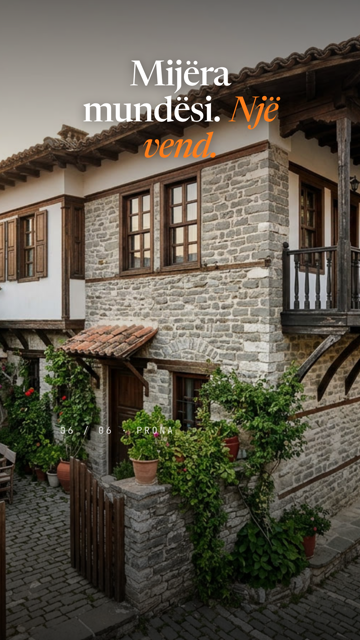

**Mode:** cinematic · **Default length:** 2.4 s · **In/out:** none / blur

A fast montage of property photographs cut every ~0.18 s (each with a short push-in), a plate-number counter that ticks on every cut, and a bold line that is already on frame 0; the last photo lands and holds. Photos are shown untouched.

| Variable | Type | Default |
|---|---|---|
| `title` | string | Mijëra mundësi. *Një vend.* |
| `photos` | string | assets/property-images/villa-coast.jpg, assets/property-images/living-tirana.jpg, assets/p |
| `cut` | number | 0.18 |
| `counter` | string | Prona |

> Default photos are the app's DEMO listing images (AI-generated). Replace with real, cleared property photos for paid campaigns. The headline must not state a listing count without a data source.

 

### `hook-question` — Question hook

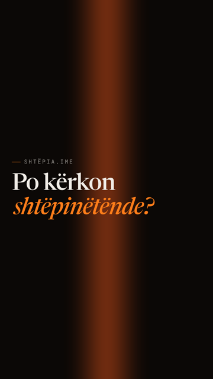

**Mode:** kinetic-typography · **Default length:** 2.4 s · **In/out:** none / blur

First two words are already on frame 0 (the thumbnail); the rest sharpen out of a blur word by word, then the italic accent payoff slams in under a soft door-light beam.

| Variable | Type | Default |
|---|---|---|
| `kicker` | string | Shtëpia.ime |
| `question` | string | Po kërkon *shtëpinë tënde?* |

 

## logo-reveals

### `logo-door-draw` — Door draw logo reveal

**Mode:** kinetic-typography · **Default length:** 3.4 s · **In/out:** none / none

The official door path is drawn as a stroke (frame then leaf), the official symbol file fades over it, then the mark lifts away as the official horizontal lockup wipes in. Never redraws the logo: both end states are the brand's own SVG files.

| Variable | Type | Default |
|---|---|---|
| `tagline` | string | Shtëpia jote. Zgjedhja jote. |
| `ground` | enum | dark |

 

### `logo-flood-stacked` — Flood to stacked logo

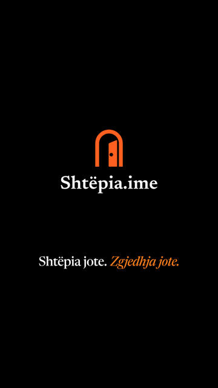

**Mode:** kinetic-typography · **Default length:** 3 s · **In/out:** flood / none

Two colour floods: orange rises from the bottom, black wipes down over it, and the official stacked lockup sharpens out of a blur on black; the closing line turns from faint to ink word by word. The orange door is never placed on orange.

| Variable | Type | Default |
|---|---|---|
| `line` | string | Shtëpia jote. *Zgjedhja jote.* |

 

### `logo-knob-pullback` — Knob light pull-back

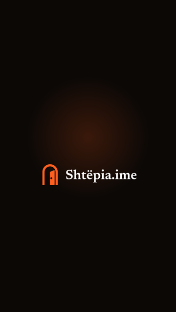

**Mode:** cinematic · **Default length:** 3.8 s · **In/out:** none / none

Starts on a single warm point of light, then pulls back through the official door symbol from 14× around its knob hole (the logo's own story: the knob is the dot of .ime), then glides onto the door position of the official horizontal lockup and hands over to it as the name sweeps out from behind the door. Never rearranges the logo: every end state is an official file.

| Variable | Type | Default |
|---|---|---|
| `handle` | string | @shtepia.ime |

 

## map-animations

### `map-albania-pins` — Albania map with city pins

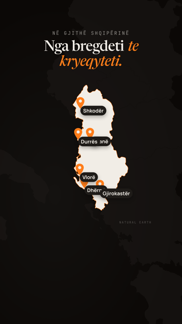

**Mode:** print · **Default length:** 3.4 s · **In/out:** none / blur

The real outline of Albania (Natural Earth, public domain) draws itself as a stroke, the land fills, neighbours fade in, and pins drop with a bounce onto the true positions of the chosen cities (projected from WGS84), each followed by its label.

| Variable | Type | Default |
|---|---|---|
| `kicker` | string | Në gjithë Shqipërinë |
| `title` | string | Nga bregdeti *te kryeqyteti.* |
| `cities` | string | shkoder, tirane, durres, vlore, dhermi, gjirokaster |

Features shown: `map-view`

 

### `map-app-clusters` — App map: zoom to clusters

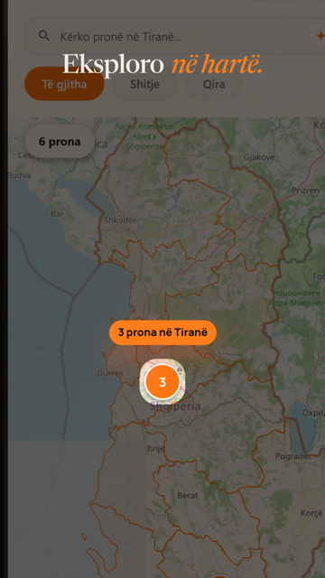

**Mode:** ui-motion · **Default length:** 3.6 s · **In/out:** none / zoom-in

Real UI only: on the explore screen the map toggle is pressed (the real pixels depress), the view switches to the real map screen, the camera flies to the Tirana cluster, everything else dims under a spotlight and a callout names the feature.

| Variable | Type | Default |
|---|---|---|
| `title` | string | Eksploro *në hartë.* |
| `from` | enum | explore |
| `region` | enum | clusterTirana |
| `callout` | string | 3 prona në Tiranë |
| `zoom` | number | 2.2 |
| `theme` | enum | light |

Features shown: `map-view`

> The callout must match what the screen shows (the Tirana cluster reads 3 on the demo data).

 

### `map-route-line` — Route between two cities

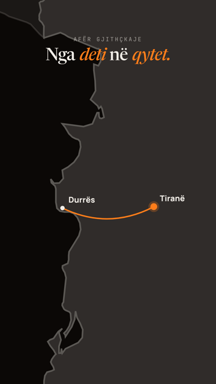

**Mode:** kinetic-typography · **Default length:** 3.2 s · **In/out:** none / blur

The map auto-frames two real cities (true projected positions), a curved route draws between them while a dot rides the exact quadratic curve, and both ends pop with their names. Good for 'from the coast to the capital' or diaspora 'from abroad to home' beats.

| Variable | Type | Default |
|---|---|---|
| `kicker` | string | Afër gjithçkaje |
| `title` | string | Nga *deti* në *qytet.* |
| `from` | enum | durres |
| `to` | enum | tirane |

 

## outros

### `outro-into-the-door` — Push into the door's knob

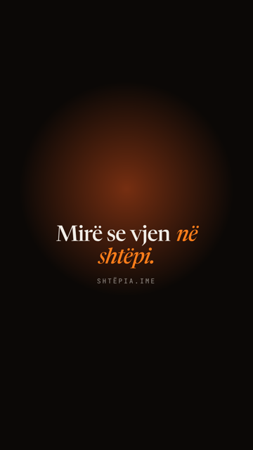

**Mode:** cinematic · **Default length:** 3.4 s · **In/out:** blur / none

The logo's own idea, reversed: the official door symbol settles, then the camera pushes into its knob (a hole that shows the ground) on a power4 ease-in until the hole becomes the whole frame, and the closing line appears inside it on a warm glow.

| Variable | Type | Default |
|---|---|---|
| `line` | string | Mirë se vjen *në shtëpi.* |
| `handle` | string | Shtëpia.ime |

 

### `outro-lockup-tagline` — Lockup + tagline end card

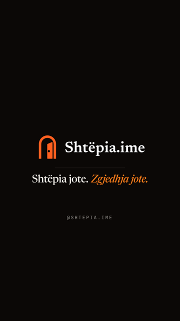

**Mode:** kinetic-typography · **Default length:** 3 s · **In/out:** blur / none

The quiet ending: the official horizontal lockup (dark or light version to match the ground) sharpens in, a hairline grows, the tagline turns from faint to ink word by word and the handle blurs in — then everything holds dead still for reading.

| Variable | Type | Default |
|---|---|---|
| `tagline` | string | Shtëpia jote. *Zgjedhja jote.* |
| `handle` | string | @shtepia.ime |
| `ground` | enum | dark |

 

### `outro-photo-endcard` — Photo grid end card

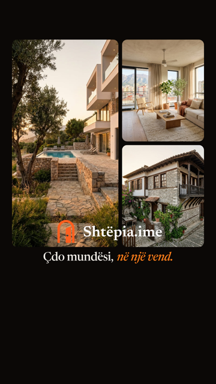

**Mode:** cinematic · **Default length:** 3.2 s · **In/out:** none / none

An editorial end card: three property photographs wipe into an asymmetric grid from three directions while each settles from 1.15×, then the official lockup and a closing line land below (beside, in landscape).

| Variable | Type | Default |
|---|---|---|
| `photos` | string | assets/property-images/villa-coast.jpg, assets/property-images/living-tirana.jpg, assets/p |
| `line` | string | Çdo mundësi, *në një vend.* |

 

## paper-cut

### `paper-cards-stack` — Paper list cards drop

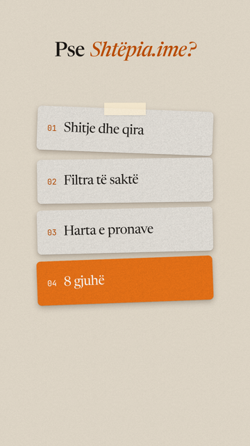

**Mode:** print · **Default length:** 3.2 s · **In/out:** none / paper

A numbered list on paper strips: each strip drops onto the table with a slight random tilt and a shadow that shrinks as it lands (lift 46 → 10 px); the last strip is orange, and a piece of tape pins the stack.

| Variable | Type | Default |
|---|---|---|
| `title` | string | Pse *Shtëpia.ime?* |
| `items` | string | Shitje dhe qira\|Filtra të saktë\|Harta e pronave\|8 gjuhë |

Features shown: `listing-type`, `filters`, `map-view`, `multilingual`

 

### `paper-key-unlock` — Paper key unlocks

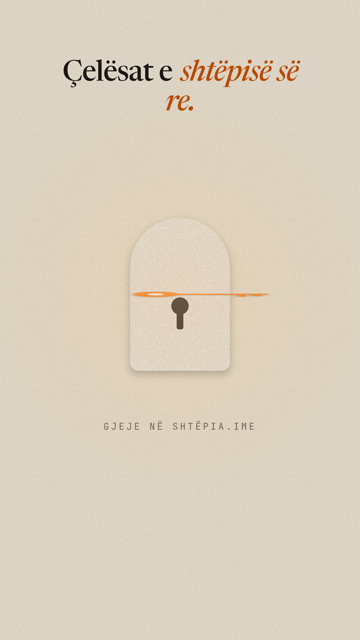

**Mode:** print · **Default length:** 2.8 s · **In/out:** none / zoom-in

A paper lock plate drops, a cut-paper key slides into the keyhole on an expo ease, turns (a scaleY flip reads as a quarter turn in flat paper) and warm light bursts out — the 'keys to your home' moment.

| Variable | Type | Default |
|---|---|---|
| `title` | string | Çelësat e *shtëpisë së re.* |
| `footer` | string | Gjeje në Shtëpia.ime |

 

### `paper-torn-reveal` — Torn-paper photo reveal

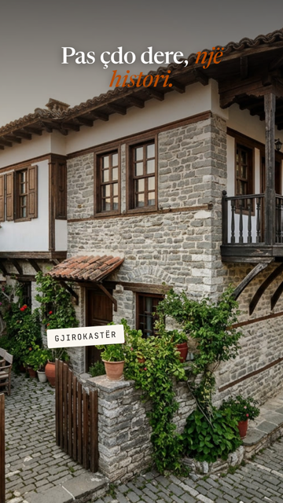

**Mode:** print · **Default length:** 3 s · **In/out:** none / blur

The frame is covered by paper strips with seeded torn edges (clip-path polygons); they are torn away one by one with a lift and spin, revealing a property photograph underneath, and a label is stamped on it. The photo is never altered.

| Variable | Type | Default |
|---|---|---|
| `title` | string | Pas çdo dere, *një histori.* |
| `photo` | string | assets/property-images/stone-house.jpg |
| `badge` | string | Gjirokastër |

 

### `paper-town-popup` — Pop-up paper town

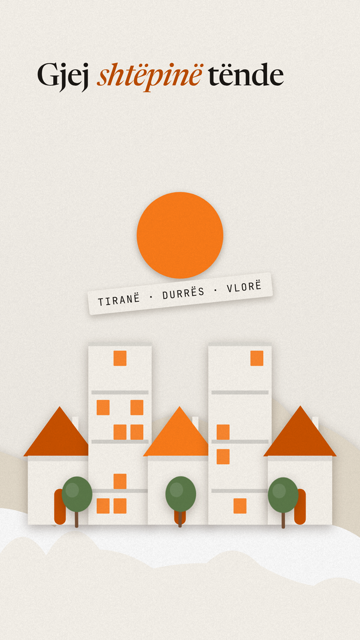

**Mode:** print · **Default length:** 3.4 s · **In/out:** none / paper

Pop-up-book construction: cut-paper hills slide up, a paper sun rises, houses and apartment blocks stand up hinged at their base (rotateX −88° → 0 with back-ease), the headline letters drop in, and a label is stamped. Contact shadows grow and shrink with each sheet's lift.

| Variable | Type | Default |
|---|---|---|
| `title` | string | Gjej *shtëpinë* tënde |
| `label` | string | Tiranë · Durrës · Vlorë |
| `seed` | number | 4 |

 

## property-cards

### `card-flip-details` — Card flips to details

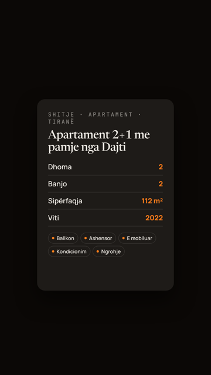

**Mode:** 3d · **Default length:** 3.4 s · **In/out:** none / zoom-out

A property card rises with a tilt, then flips a half turn in 3D (backface-hidden faces, a lift at mid-flip) from the photo + price to a details sheet whose rows (rooms, baths, m², year) and amenities come from the listing data and stagger in.

| Variable | Type | Default |
|---|---|---|
| `listing` | enum | apartment-blloku |

Features shown: `listing-detail`, `amenities`

 

### `cards-carousel` — Property card carousel

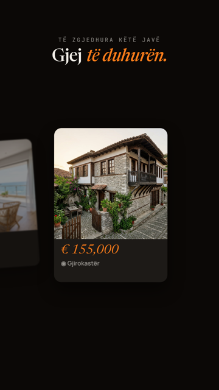

**Mode:** kinetic-typography · **Default length:** 3.6 s · **In/out:** none / whip-left

A track of motion-graphic property cards (photo, price in the app's format, city) glides past the centre; a per-frame depth falloff makes the centred card large and sharp and its neighbours smaller, rotated and softly blurred. A designed card, not app UI.

| Variable | Type | Default |
|---|---|---|
| `kicker` | string | Të zgjedhura këtë javë |
| `title` | string | Gjej *të duhurën.* |
| `listings` | string | villa-dhermi, apartment-blloku, seaside-durres, stone-gjirokaster |

> Demo listings are fictional. For a real campaign, add real listings to config/listings.json.

 

### `cards-real-lift` — Real cards lift out of the grid

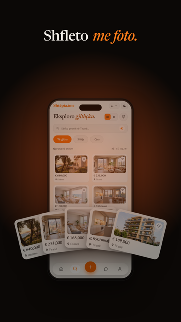

**Mode:** ui-motion · **Default length:** 3.2 s · **In/out:** none / whip-left

The six listing cards are cropped from the real explore screenshot (background-position crops, so it is the app's own pixels) and lift out of the grid one by one into a fanned hand in front of the dimming phone.

| Variable | Type | Default |
|---|---|---|
| `title` | string | Shfleto *me foto.* |
| `count` | number | 5 |
| `scale` | number | 1.45 |
| `theme` | enum | light |

Features shown: `grid-view`

 

## property-reveals

### `cine-location-title` — Cinematic location title

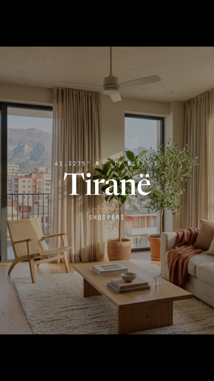

**Mode:** cinematic · **Default length:** 3.2 s · **In/out:** none / blur

Film-title treatment: the plate pulls back from 1.14× as letterbox bars close in; the place's real WGS84 coordinates appear in mono, the place name arrives letter by letter, an accent hairline draws and the region blurs in.

| Variable | Type | Default |
|---|---|---|
| `city` | enum | tirane |
| `place` | string |  |
| `region` | string | Shqipëri |
| `photo` | string | assets/property-images/living-tirana.jpg |

 

### `property-card-dive` — Dive into a listing card

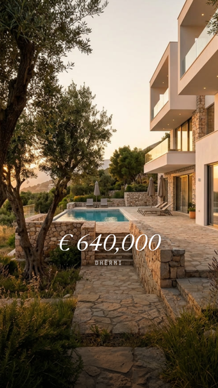

**Mode:** ui-motion · **Default length:** 3.4 s · **In/out:** none / blur

Object becomes the world: on the real explore screen the camera tracks onto one listing card, then that card's photo grows (clip-path from the card's exact on-screen rect to full frame, radius shrinking) into the full-resolution photograph; the price lands in the app's format.

| Variable | Type | Default |
|---|---|---|
| `listing` | enum | villa-dhermi |
| `theme` | enum | light |
| `zoom` | number | 1.7 |

Features shown: `grid-view`

 

### `property-kenburns-facts` — Ken Burns with facts

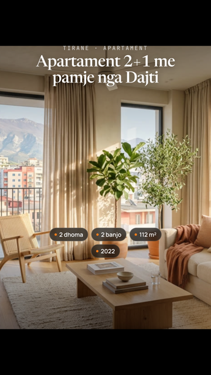

**Mode:** cinematic · **Default length:** 3.6 s · **In/out:** none / dip

Cinematic still: letterbox bars close in, a warm light band sweeps across, the camera pushes 1.0→1.1 with a slow drift, and the listing's real facts (rooms, baths, m², year from the demo data) pop in as glass chips.

| Variable | Type | Default |
|---|---|---|
| `listing` | enum | apartment-blloku |
| `photo` | string |  |
| `title` | string |  |

Features shown: `listing-detail`

 

### `property-shutter-reveal` — Shutter-slat property reveal

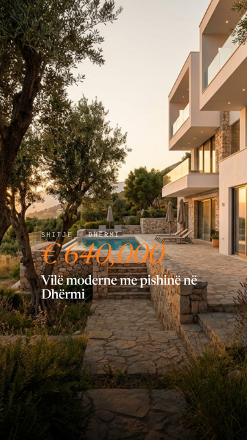

**Mode:** cinematic · **Default length:** 3.4 s · **In/out:** none / blur

The photo is cut into vertical slats that open from the centre outwards like shutters while the whole plate settles from 1.12×; the price counts up in the app's own format and the title sharpens in over a bottom scrim.

| Variable | Type | Default |
|---|---|---|
| `listing` | enum | villa-dhermi |
| `photo` | string |  |
| `title` | string |  |
| `slats` | number | 7 |

Features shown: `listing-detail`

 

## search-animations

### `search-chips-assemble` — Search chips assemble

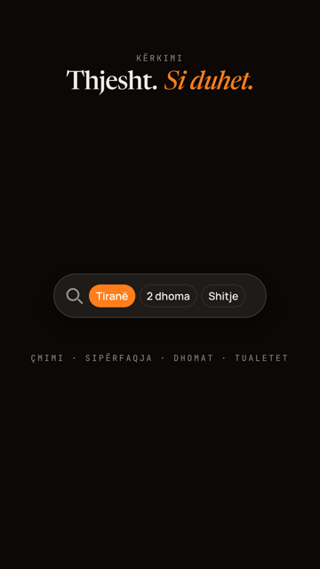

**Mode:** kinetic-typography · **Default length:** 3 s · **In/out:** none / zoom-in

A typographic search bar (a designed graphic, not app UI) unrolls, and filter chips fly in from scattered positions with rotation and snap into it on a back-ease, the first one in the accent — the idea of filtering in one image.

| Variable | Type | Default |
|---|---|---|
| `kicker` | string | Kërkimi |
| `title` | string | Thjesht. *Si duhet.* |
| `chips` | string | Tiranë, 2 dhoma, Shitje |
| `footer` | string | Çmimi · Sipërfaqja · Dhomat · Tualetet |

Features shown: `filters`, `listing-type`

 

### `search-filters-sheet` — Filters sheet walkthrough

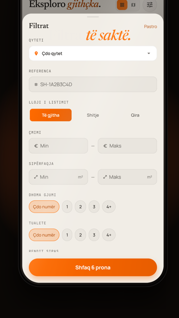

**Mode:** ui-motion · **Default length:** 4.6 s · **In/out:** none / blur

Real UI walkthrough: the filter button on the explore screen is pressed, the real filters sheet rises, and the camera visits each filter group (price, bedrooms…) with a callout before pulling back and pressing 'Shfaq 6 prona'.

| Variable | Type | Default |
|---|---|---|
| `title` | string | Filtra *të saktë.* |
| `stops` | string | price, bedrooms |
| `labels` | string | Buxheti yt, Sa dhoma? |
| `zoom` | number | 1.7 |
| `theme` | enum | light |

Features shown: `filters`, `price-filter`, `rooms-filter`

 

### `search-type-results` — Type a search, see results

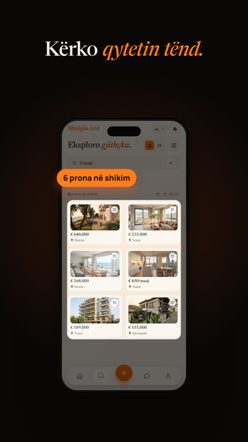

**Mode:** ui-motion · **Default length:** 4 s · **In/out:** none / blur

The camera flies into the real search field, a query is typed into it at reading pace (with caret), then pulls back to the real results grid, which is spotlit with a callout taken from the screen's own count line.

| Variable | Type | Default |
|---|---|---|
| `title` | string | Kërko *qytetin tënd.* |
| `query` | string | Tiranë |
| `screen` | enum | explore |
| `callout` | string | 6 prona në shikim |
| `zoom` | number | 1.9 |
| `theme` | enum | light |

Features shown: `search`, `grid-view`

> The callout must match the screen ('6 prona në shikim' is what the explore screenshot shows).

 

## smartphone-reveals

### `phone-3d-spin` — 3D phone spin

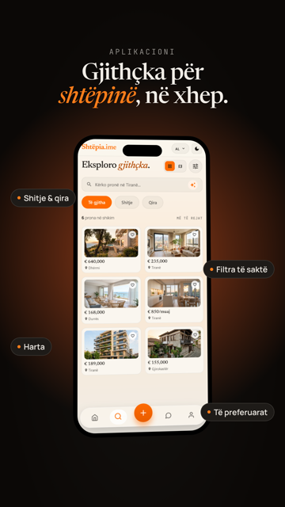

**Mode:** 3d · **Default length:** 3.4 s · **In/out:** none / blur

A phone with real thickness (stacked CSS-3D slices, rounded rim, glass) spins in from edge-on and settles into a slow orbit with a real screen on its face; feature chips (from features.json claims) pop out on alternating sides.

| Variable | Type | Default |
|---|---|---|
| `kicker` | string | Aplikacioni |
| `title` | string | Gjithçka për *shtëpinë*, në xhep. |
| `screen` | screen | explore |
| `theme` | enum | light |
| `chips` | string | Shitje & qira, Filtra të saktë, Harta, Të preferuarat |

Features shown: `listing-type`, `filters`, `map-view`, `favorites`

 

### `phone-rise` — Phone rise

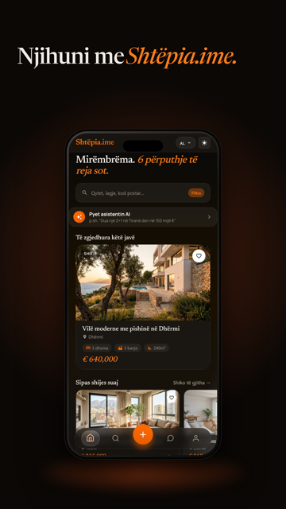

**Mode:** ui-motion · **Default length:** 3.2 s · **In/out:** none / blur

A real app screen in a CSS phone rises from below with a 24° tilt that settles on a long expo tail, a band of light crosses the glass, and the caption rises word by word. Optional push-navigation to a second real screen before the cut.

| Variable | Type | Default |
|---|---|---|
| `title` | string | Njihuni me *Shtëpia.ime.* |
| `screen` | screen | home |
| `next` | string |  |
| `theme` | enum | dark |

Features shown: `search`, `featured`

 

### `phone-trio-fan` — Three phones fan out

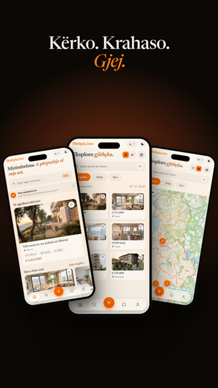

**Mode:** ui-motion · **Default length:** 3.2 s · **In/out:** none / zoom-in

Three phones with three real screens rise together as one stack, then the outer two fan out with a rotation (the centre stays on top) — a whole-product overview in one move.

| Variable | Type | Default |
|---|---|---|
| `title` | string | Kërko. Krahaso. *Gjej.* |
| `screens` | string | home, explore, map |
| `theme` | enum | light |

Features shown: `search`, `grid-view`, `map-view`

 

## statistics

### `stat-big-number` — Big number with ring

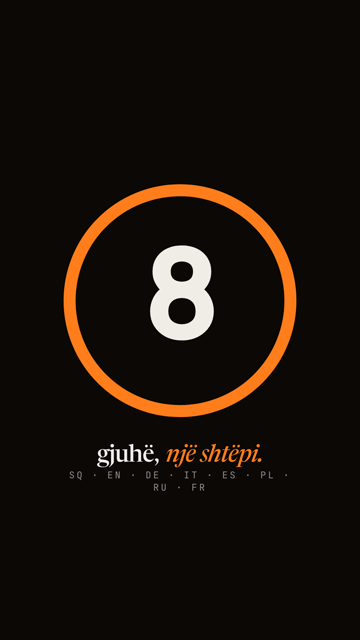

**Mode:** kinetic-typography · **Default length:** 3 s · **In/out:** none / zoom-in

A full-width display number counts up (1.4 s, power3.out, lands and holds) while a progress ring draws round it; the unit pops in the accent and a label sharpens below. Only for numbers with a source (features.json or real data).

| Variable | Type | Default |
|---|---|---|
| `value` | number | 8 |
| `prefix` | string |  |
| `unit` | string |  |
| `label` | string | gjuhë, *një shtëpi.* |
| `source` | string | sq · en · de · it · es · pl · ru · fr |
| `ring` | number | 100 |

Features shown: `multilingual`

> Never put user, download or listing counts here without a real data source (features.json → neverClaim).

 

### `stat-facts-grid` — Facts grid with drawn icons

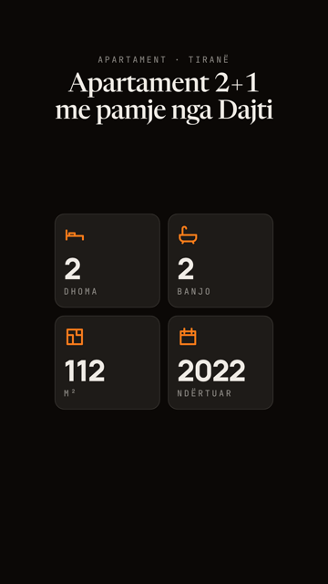

**Mode:** kinetic-typography · **Default length:** 3 s · **In/out:** none / whip-up

A 2×2 grid (4×1 in landscape) of fact tiles rises with a stagger; in each, a line icon drawn for the kit (bed, bath, area, calendar) draws itself on while its number counts up — rooms, baths, m² and year straight from the listing data.

| Variable | Type | Default |
|---|---|---|
| `listing` | enum | apartment-blloku |
| `title` | string |  |

Features shown: `listing-detail`

 

### `stat-price-counter` — Odometer price reveal

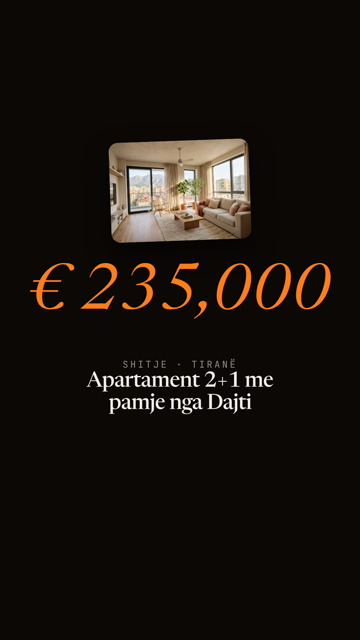

**Mode:** kinetic-typography · **Default length:** 3 s · **In/out:** none / blur

Odometer: every digit of the price (in the app's '€ 235,000' format) is a vertical strip that rolls to its value, right-hand columns rolling more turns so the number settles left to right; a tilted photo card of the listing sits above.

| Variable | Type | Default |
|---|---|---|
| `listing` | enum | apartment-blloku |
| `title` | string |  |

Features shown: `listing-detail`

 

## talking-head

### `th-broll-card` — B-roll card over speaker

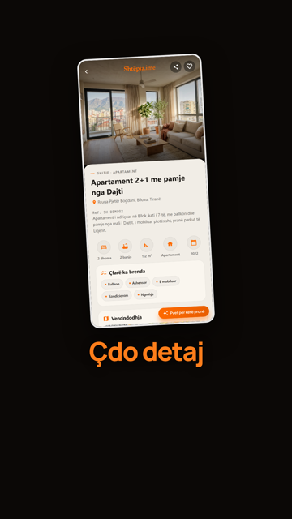

**Mode:** talking-head · **Default length:** 2.6 s · **In/out:** none / none · **Overlay** (sits on a seam or over footage)

While the speaker keeps talking, a framed card (a real screen or a property photo) pops in above the face line on a back-ease with a slight tilt, and the spoken keyword slams in under it; both leave together. Cut it on the sentence that names the thing.

| Variable | Type | Default |
|---|---|---|
| `screen` | string | detail-1 |
| `image` | string | assets/property-images/living-tirana.jpg |
| `keyword` | string | *Çdo detaj* |
| `rotate` | number | -3 |
| `theme` | enum | light |

Features shown: `listing-detail`

 

### `th-captions` — Word-by-word captions

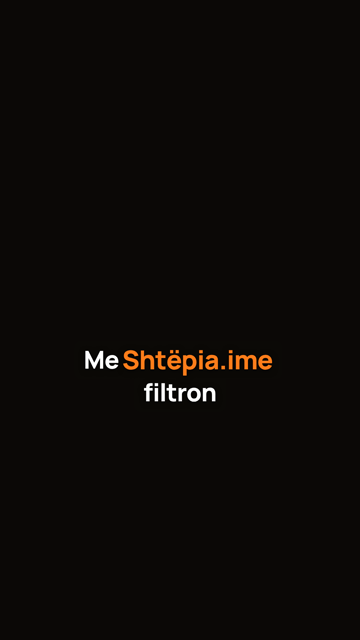

**Mode:** talking-head · **Default length:** 10 s · **In/out:** none / none · **Overlay** (sits on a seam or over footage)

Captions from a real transcript (word-level timings): words grouped on pauses ≥150 ms, punctuation or a word limit; one group at a time, each word lighting up exactly on its spoken start, keywords turning accent and slightly larger; every group hard-killed after its last word.

| Variable | Type | Default |
|---|---|---|
| `text` | string | Po kërkon shtëpi në Tiranë? Me Shtëpia.ime filtron sipas çmimit dhe dhomave, dhe i sheh të |
| `keywords` | string | Tiranë, Shtëpia.ime, hartë |
| `groupSize` | number | 3 |
| `size` | number | 74 |

 

### `th-lower-third` — Lower third

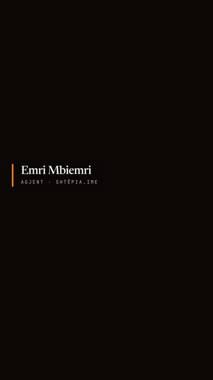

**Mode:** talking-head · **Default length:** 3.5 s · **In/out:** none / none · **Overlay** (sits on a seam or over footage)

A glass lower third with an accent bar wipes in from the left (clip-path), the name (serif) and role (mono) slide in staggered, it holds, then wipes out to the right. Sits inside the title-safe band, clear of the face.

| Variable | Type | Default |
|---|---|---|
| `name` | string | Emri Mbiemri |
| `role` | string | Agjent · Shtëpia.ime |

> Replace the placeholder name with the real speaker's name and role.

 

### `th-split-screen` — Split screen: speaker + app

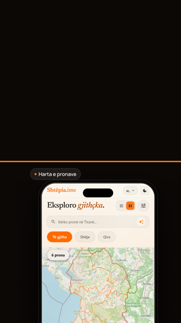

**Mode:** talking-head · **Default length:** 4 s · **In/out:** none / none · **Overlay** (sits on a seam or over footage)

Half of the frame slides in over the speaker's footage (bottom half in 9:16, right half in 16:9) with an accent divider, carrying a phone with a real screen that zooms to the feature the speaker names. Pair with storyboard footage rect {top:0,height:'50%'}.

| Variable | Type | Default |
|---|---|---|
| `screen` | screen | map |
| `region` | string | clusterTirana |
| `tag` | string | Harta e pronave |
| `theme` | enum | light |

Features shown: `map-view`

 

## transitions

### `tx-door-iris` — Doorway iris (overlay)

**Mode:** kinetic-typography · **Default length:** 1 s · **In/out:** none / none · **Overlay** (sits on a seam or over footage)

Overlay transition shaped like an arched doorway (evenodd clip-path path): the ground closes in through a shrinking door until the frame is covered, then the door opens again onto the next scene.

 

### `tx-orange-wipe` — Orange band wipe (overlay)

**Mode:** kinetic-typography · **Default length:** 0.8 s · **In/out:** none / none · **Overlay** (sits on a seam or over footage)

Overlay transition: three skewed bands (accent, deep accent, ground) sweep across in sequence, covering the frame at the slot's midpoint. Place it over a seam with "overlap" so the cut underneath happens while the frame is covered.

 

### `tx-paper-sweep` — Paper sheet sweep (overlay)

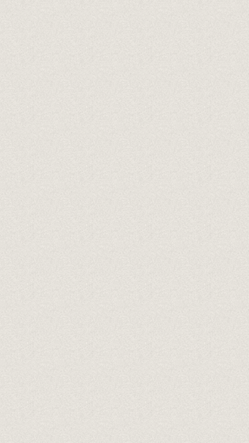

**Mode:** print · **Default length:** 0.9 s · **In/out:** none / none · **Overlay** (sits on a seam or over footage)

Overlay transition for print films: a torn-edged paper sheet with a deep contact shadow slides up over the frame, covers it at mid-slot, and continues out of the top.

 

## typography

### `type-3d-extrude` — Extruded 3D type

**Mode:** 3d · **Default length:** 3 s · **In/out:** none / zoom-in

Solid 3D lettering without WebGL: 18 copies of the word stacked in depth (translateZ) with shading from accent to deep shadow, swung in from a 55° angle and slowly orbiting so the extrusion reads.

| Variable | Type | Default |
|---|---|---|
| `word` | string | Shtëpia |
| `sub` | string | Gjej. Ruaj. Hyr brenda. |

 

### `type-flash-rsvp` — One word per beat

**Mode:** kinetic-typography · **Default length:** 2.4 s · **In/out:** cut / cut

RSVP: one word at a time fills the frame (each fitted to the safe width), arriving with a 1.25→1 snap and cutting hard to the next, while a thin progress bar runs at constant speed. Time 'each' to the music's beat.

| Variable | Type | Default |
|---|---|---|
| `words` | string | Kërko.\|Krahaso.\|Ruaj.\|*Gjej.* |

 

### `type-highlighter` — Highlighter marks

**Mode:** kinetic-typography · **Default length:** 2.8 s · **In/out:** none / blur

A sentence sits still while a translucent orange highlighter band sweeps under each [marked] phrase in turn (background-size band with box-decoration-break so it wraps across lines).

| Variable | Type | Default |
|---|---|---|
| `text` | string | [Shitje] dhe [qira], me [foto dhe hartë]. |

Features shown: `listing-type`, `map-view`

 

### `type-mask-lines` — Editorial line masks

**Mode:** kinetic-typography · **Default length:** 3.4 s · **In/out:** none / blur

Magazine layout in the app's own voice: mono kicker with an accent dash, a serif headline whose lines (split where the writer puts '|') rise out of masks, an accent rule grows, and the body copy turns from faint to ink word by word at reading pace.

| Variable | Type | Default |
|---|---|---|
| `kicker` | string | Shtëpia.ime |
| `title` | string | Tregu i pronave,\|*më i qartë*\|se kurrë. |
| `body` | string | Çmime, foto, harta dhe detaje — në shqip, anglisht, italisht dhe në 5 gjuhë të tjera. |

Features shown: `multilingual`, `map-view`, `listing-detail`

 

### `type-split-word` — Split word reveals a line

**Mode:** kinetic-typography · **Default length:** 3 s · **In/out:** none / blur

One fitted word is built from two masked halves (ink top, accent bottom) closed on an accent seam — already on frame 0, so it works as an opener — then the halves split apart vertically to reveal a second line hidden inside the word.

| Variable | Type | Default |
|---|---|---|
| `word` | string | Shtëpia |
| `inside` | string | fillon me *një kërkim.* |

 

### `type-stack-poster` — Stacked poster type

**Mode:** kinetic-typography · **Default length:** 2.6 s · **In/out:** none / shutter

Poster stack: every line is fitted to the full safe width (canvas-measured, so 'HOME' and 'SHTËPIA' fill the same width at different sizes) and rises out of its own mask with overlapping timing; mono footers frame it like a print poster.

| Variable | Type | Default |
|---|---|---|
| `lines` | string | Gjej\|*shtëpinë*\|tënde |
| `footLeft` | string | Shtëpia.ime |
| `footRight` | string | Shitje · Qira |

 

## ui-transitions

### `ui-push-nav` — Push navigation flow

**Mode:** ui-motion · **Default length:** 4.2 s · **In/out:** none / blur

An app journey across real screens: each step presses the real element that leads to the next screen (its pixels depress), then the next screen pushes in from the right iOS-style while a numbered step label changes below.

| Variable | Type | Default |
|---|---|---|
| `title` | string | Nga kërkimi *te shtëpia.* |
| `flow` | string | home, explore, detail-1 |
| `taps` | string | search, card2 |
| `steps` | string | Kërko, Shfleto, Zbulo detajet |
| `theme` | enum | light |

Features shown: `search`, `grid-view`, `listing-detail`

> card2 on explore is the Blloku apartment, which is exactly detail-1: keep taps and the next screen consistent.

 

### `ui-screens-wall` — Wall of real screens

**Mode:** 3d · **Default length:** 3.4 s · **In/out:** zoom-out / blur

Every real screen (light and dark) tiled on a tilted 3D wall; alternate columns scroll in opposite directions at constant speed while the wall drifts towards camera behind a vignette and a centred headline. Product UI is shown flat on the wall plane, never distorted per-screen.

| Variable | Type | Default |
|---|---|---|
| `kicker` | string | Ditë apo natë |
| `title` | string | Çdo mundësi, *në një vend.* |

Features shown: `dark-mode`

 

### `ui-zoom-through-search` — Zoom through the search field

**Mode:** ui-motion · **Default length:** 2.6 s · **In/out:** none / none

A transition with a cause: the camera tracks to the real search field, then zooms through it (9×, power4 ease-in, motion blur peaking at the fastest frame) and an accent iris opens from its centre into a full-frame typographic beat.

| Variable | Type | Default |
|---|---|---|
| `line` | string | Një kërkim. *Gjithë Shqipëria.* |
| `screen` | enum | home |
| `region` | string | search |
| `theme` | enum | light |

Features shown: `search`

 
